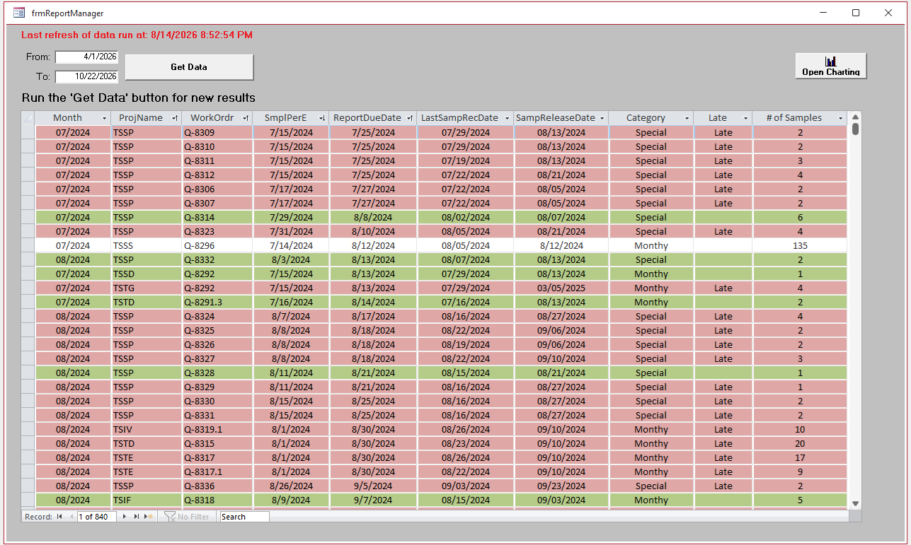
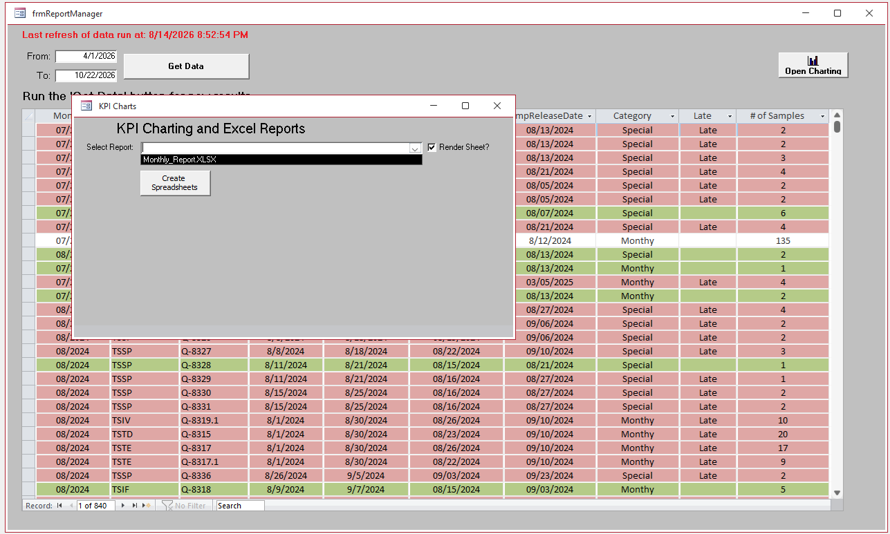
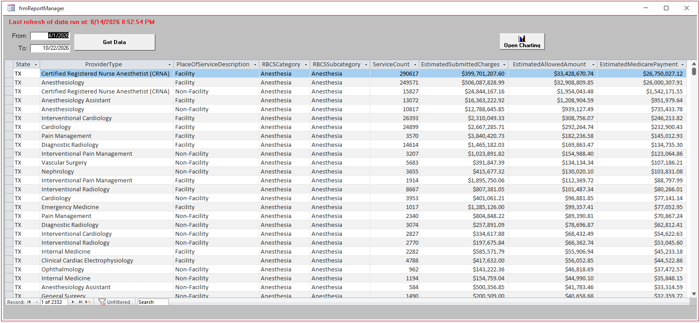
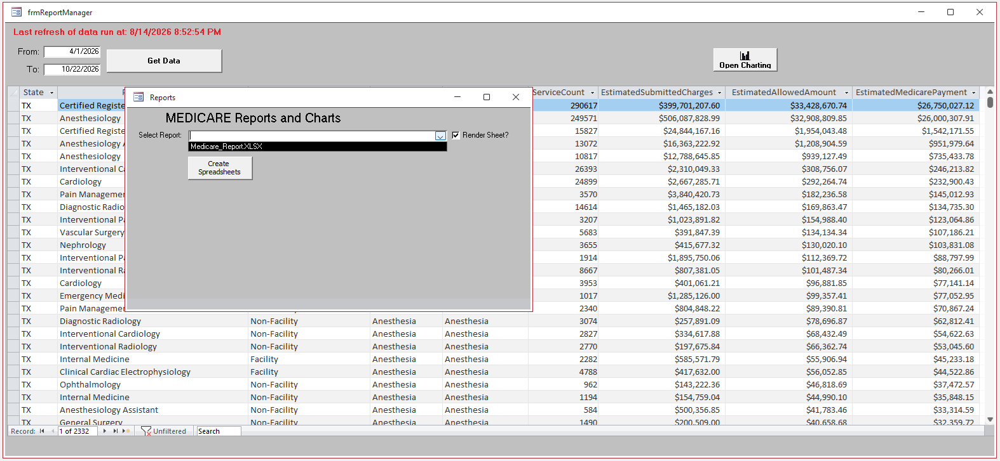

# Metadata-Driven Excel Reporting Engine

A Microsoft Access reporting framework that turns ordered SQL, report metadata, sorting tables, and Excel COM automation into structured `.xlsx` workbooks.

This repository demonstrates a practical reporting architecture for recurring business reports that need more than a flat data export but do not require a specialized financial, scientific, or engineering reporting platform. The engine separates application-specific data preparation from reusable workbook construction, making it possible to generate grouped report bands, formulas, subtotals, grand totals, hidden helper columns, and charts from metadata.

## What This Project Demonstrates

- Microsoft Access SQL pipelines controlled by metadata
- DAO QueryDef creation and action-query execution
- ADO recordset transfer into Excel
- Excel COM automation from VBA
- Multiple worksheets from one report definition
- Dynamic report bands based on sorting and grouping tables
- Metadata-generated formulas, formatting, headers, footers, subtotals, and grand totals
- Hidden helper columns and running calculations
- Programmatically generated charts
- Standalone `.xlsx` output without Access reports

## Documentation

### Start Here

- [Getting Started](Docs/GettingStarted.md)  
  Step-by-step instructions for configuring a new report, worksheet source, sorting table, metadata layout, and `tblReportSequence`.

- [Architectural White Paper](Docs/WhitePaper.md)  
  Detailed explanation of the reporting architecture, SQL orchestration, break calculation, metadata model, and Excel rendering process.

### Configuration References

- [Metadata Configuration Guide](Docs/MetadataConfigurationGuide.md)  
  Reference for H1, B, B_D, F1, and F2 report zones, formula tokens, hidden helper columns, section-wide metadata, and grand totals.

- [`tblReportSequence` Reference](Docs/TblReportSequenceReference.md)  
  Field-by-field guide to SQL execution order, QueryDef creation, table cleanup, worksheet sources, sorting tables, totals, and spacing overrides.

- [Troubleshooting Guide](Docs/Troubleshooting.md)  
  Diagnostic guidance for SQL, sequence, sorting-table, metadata, formula, rendering, calculation, and chart problems.

### Worked Examples

- [Medicare Pipeline](Docs/WorkedExamples/MedicarePipeline.md)  
  Complete walkthrough from public Medicare and RBCS data through Access SQL, `tblReportSequence`, report-band construction, totals, and Excel output.

- [KPI Pipeline](Docs/WorkedExamples/KPIPipeline.md)  
  Complete walkthrough of the two-worksheet KPI workbook, separate sorting tables, hidden helper columns, running footer calculations, grand totals, and charts.

## Reference Implementations

The repository contains two complementary demonstrations.

### Medicare Demo

The Medicare demo is the current reference implementation. It uses public CMS Medicare Physician and Other Practitioners data and the CMS Restructured BETOS Classification System taxonomy to build a Texas provider summary.

The pipeline:

1. Imports the Medicare practitioner dataset and RBCS taxonomy.
2. Normalizes taxonomy values and selects the current RBCS release per HCPCS code.
3. Joins Medicare records to the current taxonomy.
4. Filters the source to Texas.
5. Groups activity by provider type, place of service, RBCS category, and RBCS subcategory.
6. Calculates estimated submitted charges, allowed amounts, and Medicare payments.
7. Produces a report-ready Access source and sorting table.
8. Passes the prepared output to the metadata-driven Excel renderer.
9. Generates a formatted worksheet and Medicare Top 10 chart.

The current Medicare renderer also includes safer header and footer override handling and forces a complete Excel recalculation before saving the workbook.

### KPI Demo

The KPI demo is an earlier reference implementation retained because it demonstrates broader workbook orchestration:

- Two report worksheets: `KPI_Monthly` and `KPI_Special`
- Two chart worksheets
- Dynamically sized monthly report bands
- Default blank header and footer override behavior
- Hidden calculated helper columns
- Footer running counts
- Worksheet-level grand totals
- Multiple formula-token patterns
- Broader `tblReportSequence` orchestration

The prepared object named `qryKPI_Results` is a local Access table despite its query-style prefix. Saved select queries divide the prepared source into Monthly and Special result sets before `tblReportSequence` materializes the demonstrated worksheet-source and sorting tables.

## User Workflow

The host application and reporting engine are intentionally separated.

1. `frmReportManager` displays prepared, application-specific data.
2. The user opens `frmReportLauncher`.
3. The user selects a report definition.
4. The optional **Render Sheet?** setting controls whether Excel remains visible while the workbook is built.
5. The user selects **Create Spreadsheets**.
6. The engine executes the configured SQL sequence, creates worksheets, transfers recordsets, calculates report bands, applies metadata, creates charts, and saves the workbook.
7. The launcher displays a hyperlink to the completed file.

## Demo Screenshots

### KPI Report Manager



### KPI Reporting Workflow



### Medicare Report Manager



### Medicare Reporting Workflow




## Architecture

```text
Host application
    |
    | parameters and source-specific preparation
    v
Report-ready Access source
    |
    | ordered instructions in tblReportSequence
    v
SQL and QueryDef orchestration
    |
    | final worksheet sources + sorting tables
    v
ADO recordset transfer to Excel
    |
    | calculated break coordinates
    v
Metadata-driven formatting and formulas
    |
    | charts, totals, recalculation, save
    v
Standalone XLSX workbook
```

### Layer 1: Host Application

The host application owns source-specific behavior:

- User parameters
- Data retrieval
- Application-specific joins and calculations
- Preparation of report-ready records
- Preview of the prepared result

In the public demos, the **Get Data** button is instructional and the sample data is already prepared. A production host application can replace this event with its own retrieval and SQL pipeline.

### Layer 2: Report Orchestrator

`frmReportLauncher` reads `tblReportSequence`, clears disposable output tables, creates or replaces QueryDefs, builds the worksheet and spacing views, and passes the resulting execution contract to `createSpreadsheetReport`.

### Layer 3: Workbook Generator

`modExportToExcel` and `clsExport` perform the reusable workbook work:

- Create or replace the output workbook
- Create and name worksheets
- Open configured sources through ADO
- Copy returned records beginning at cell `A2`
- Calculate grouping breaks
- Insert report-band rows
- Apply formatting metadata
- Generate formulas and totals
- Hide helper columns
- Create charts
- Save a standalone `.xlsx` file

## `tblReportSequence`: The Execution Manifest

`tblReportSequence` is more than a settings table. It is the ordered execution manifest for a report.

Important fields include:

- `Report`: identifies the workbook/report definition
- `Sort`: establishes execution order
- `QueryName`: names the table or QueryDef associated with the row
- `SQL`: stores Access SQL used to create the QueryDef or execute an action
- `Exec`: determines whether the created QueryDef is executed
- `isTable?`: selects the table-cleanup path instead of the QueryDef-creation path
- `FinalOutput`: identifies objects copied into worksheets
- `Tab`: identifies a worksheet source and worksheet name
- `Tab Order`: controls worksheet processing order
- `Spacing`: associates a sorting/grouping object with a worksheet
- `Spacing Order`: controls grouping-level order
- `HasTotals`: enables report-level grand totals
- `Over_ride_head1`: optionally changes the primary header allocation
- `Over_ride_foot1`: optionally changes the primary footer allocation

### Table and QueryDef Lifecycle

The engine uses two preparation routes:

```text
isTable? = True
    -> treat QueryName as a disposable output/cache table
    -> delete the existing table before recreation

isTable? = False
    -> treat QueryName as a QueryDef
    -> delete and recreate the QueryDef
    -> execute it only when Exec = True
```

During final worksheet transfer, ADO opens the configured `QueryName` and copies the returned recordset into Excel. The demonstrated configurations use materialized local tables as final worksheet sources. The implementation also supports creating a saved select QueryDef with `Exec = False`; because the transfer stage opens a named record-returning object through ADO, a saved select query can be used as a final source when it returns the required fields and has no unresolved parameters. This direct-query path is supported by the code but is not represented by the supplied demo configurations.

## Sorting-Table Contract

Each formatted worksheet requires one or more sorting/grouping sources. The primary sorting table must expose the fields expected by `fn_FindBreaks`.

The first three columns are especially important:

1. A numeric or sortable grouping key
2. A display description for the group
3. A record count for the group

The engine reads the sorting tables, writes their names to `tblNameHolder`, and recursively calculates the physical coordinates of every report band. The generated `tbl_temp_sorting_grouping` table contains values such as:

- Header beginning and ending rows
- Detail beginning and ending rows
- Summary beginning and ending rows
- Inserted-row counts
- Group description
- Sorting level

These coordinates drive all later formatting and formula placement.

> **Important:** `fn_FindBreaks` depends on the expected sorting-table headers and column order. A table with the correct data but the wrong first three fields can produce incorrect grouping or fail during break calculation.

## Metadata-Driven Excel Layout

The active report metadata is stored primarily in:

- `tblGoodFieldName_Report`
- `tblGoodFieldName_G_Totals`

Each ordinary report band contains several logical zones:

```text
H1   Primary group header
B    Body or column-heading row
B_D  Detail-data rows
F1   Primary subtotal or summary row
F2   Extended footer or additional summary rows
```

Metadata controls:

- Destination Excel letters
- Column widths and hidden columns
- Labels and values copied from data
- Fonts, sizes, styles, colors, and number formats
- Alignment and wrapping
- Row heights
- Borders and fills
- Merge behavior
- Detail formulas
- Footer formulas
- Extended footer values
- Grand-total formatting

### Read Metadata in Two Dimensions

A metadata record usually corresponds to an Excel output column, but not every field is column-specific.

#### Column-specific settings

These are normally evaluated once per metadata record:

- `Letter`
- `ColumnWidth`
- `Column_Hide`
- `FieldName_B`
- Detail formatting fields
- `Range_B_D`
- `FieldName_F1`
- `Range_F1`

#### Repeatable header and footer items

Multiple metadata records can define positioned label/data items:

- `HeaderCol_H1_A`
- `FieldName_H1_A`
- `Add_Name_From_Data_H1_A`
- `Position_H1_A`
- `HeaderCol_F2_A`
- `FieldName_F2_A`
- `Add_Name_From_Data_F2_A`
- `Position_F2_A`

#### Section-wide settings

Some properties apply to an entire multi-column report zone. The code determines the first and last visible Excel columns, constructs one range, then reads shared settings from the first metadata record in `Sort` order.

Examples include:

- `Merge_Center_H1`
- `ColorIndex_H1`
- `Row_Height_H1`
- H1 border settings
- `Merge_Center_F2`
- `ColorIndex_F2`
- `Row_Height_F2`
- F2 border settings
- Body and detail boundary settings

Developers should treat the first sorted metadata record as the authoritative row for section-wide settings. Repeating or changing the same section-wide value on later records may have no effect.

## Formula Tokens

Formula metadata is stored without a leading equals sign because the VBA adds `=` when assigning the formula to Excel.

### `?`

`?` is replaced with a context-specific row number.

Example detail formula:

```text
(L?-K?)/L?
```

### `@` and `#`

For footer formulas:

- `@` represents the first detail row in the current band.
- `#` represents the last detail row in the current band.

Example:

```text
SUM(K@:K#)
```

The engine converts the tokens into the actual Excel row coordinates for each generated band.

## Active and Reserved Metadata Fields

The schema contains fields that are not consumed by the current reference renderer. Their presence in a table does not activate the corresponding behavior.

Currently unconfirmed or unimplemented fields include:

- `PasteSpecial`
- `PasswordProtect`
- `Password`
- `List_B`
- `ErrorTitle_B`
- `ErrorMessage_B`
- `Lock_B`

Treat these fields as reserved or legacy unless the current renderer is extended and tested to consume them.

## Safe Header and Footer Overrides

The renderer provides default allocations for primary and secondary headers and footers. `Over_ride_head1` and `Over_ride_foot1` allow a worksheet definition to replace the primary defaults.

The current Medicare implementation applies an override only when the value is not null. A blank override therefore falls back safely to the default allocation rather than collapsing the report band.

## Chart Generation

The demonstrations use code-based charts rather than a fully generic chart-metadata subsystem.

- The KPI renderer calls chart functions for worksheet charts and grand-total chart content.
- The Medicare renderer creates a Top 10 chart from the completed worksheet data.

Chart creation occurs after the worksheet sources, report bands, formulas, and totals have been prepared.

## Repository Structure

```text
MetadataDrivenReportingEngine/
|-- README.md
|-- Docs/
|   |-- WhitePaper.md
|   |-- GettingStarted.md
|   |-- MetadataConfigurationGuide.md
|   |-- TblReportSequenceReference.md
|   |-- Troubleshooting.md
|   `-- WorkedExamples/
|       |-- MedicarePipeline.md
|       `-- KPIPipeline.md
|-- Screenshots/
|   |-- KPI_ReportManager.png
|   |-- KPI_ReportWorkflow.png
|   |-- Medicare_ReportManager.png
|   `-- Medicare_ReportWorkflow.png
|-- VBA/
|   |-- basBrowse.txt
|   |-- clsCreateRecord.txt
|   |-- clsExport.txt
|   |-- Connections.txt
|   |-- modOpenFile.txt
|   |-- modMousePointer.txt
|   |-- modExportToExcel.txt
|   |-- modCreateQdef.txt
|   `-- mod_IsReportOpen.txt
|-- SQL/
|   |-- Medicare/
|   `-- KPI/
`-- Demo/
    |-- DemoKPI_ExcelWriter.xlsx
    |-- ReportKPI.accdb
    `-- ReportMedicareDemo.accdb
```

## Running a Demo

1. Download the desired `.accdb` demo and place it in a local folder.
2. Open the database in Microsoft Access.
3. If Windows blocks the VBA project, unblock the downloaded file or place the demo in a trusted location.
4. Open `frmReportManager`.
5. Review the prepared sample records.
6. Select **Open Charting**.
7. Choose the report definition in `frmReportLauncher`.
8. Optionally select **Render Sheet?** to watch Excel while the report is constructed.
9. Select **Create Spreadsheets**.
10. Choose an output filename and location.
11. After processing completes, use the hyperlink displayed by the launcher to open the generated workbook.

## Windows and Office Notes

The project uses Windows APIs, Access, VBA, DAO, ADO, and Excel COM automation. The public demo code includes 64-bit-compatible declarations where required.

A downloaded Access database may be blocked by Windows. If an **Unblock** option appears in the file properties, enable it before opening the database. A trusted folder may also be used for development and generated report output.

The demos require Microsoft Access and desktop Excel on Windows. The generated workbook is saved as a standalone `.xlsx` file and does not require Access to view after generation.

## Practical Testing Strategy

Before testing a new report against a large dataset, use a controlled source with approximately 99 rows. This is large enough to exercise multiple report bands, formulas, subtotals, and row insertion while remaining small enough to inspect manually.

Validate, in order:

1. Source field names and order
2. Sorting-table headers and counts
3. `tblReportSequence` order
4. Worksheet and spacing associations
5. Header and footer allocations
6. Hidden helper columns
7. Formula-token replacement
8. Totals and grand totals
9. Chart source ranges
10. Workbook recalculation and saved values

## Known Constraints

- The engine targets recurring business reports, not specialized financial, scientific, or engineering models.
- Sorting tables must satisfy the expected contract.
- Metadata is powerful but not self-validating.
- Section-wide settings can be misleading if entered on non-authoritative metadata rows.
- Some schema fields are reserved or unimplemented.
- Parameterized final-output queries require parameters to be resolved before ADO opens the recordset.
- Chart behavior is implementation-specific in the supplied demos.
- Excel COM automation is Windows desktop technology and can be sensitive to workbook state, calculation mode, and orphaned Excel processes during debugging.

## Why This Architecture Matters

Many operational reports fall between two extremes:

- A simple data export is not enough.
- A specialized reporting platform is unnecessary or unavailable.

This engine addresses that middle ground. It keeps business-specific SQL and data preparation in Access while moving workbook layout, grouping, formulas, and formatting into reusable metadata and VBA components. The result is a practical reporting system that can be adapted without rewriting the entire Excel-generation pipeline for every report.

## About the Author

Alex Fritts is a workflow and reporting automation developer focused on Microsoft Access, SQL-backed business applications, VBA, COM automation, and metadata-driven Excel reporting.

## Documentation Status

This README is the project overview. The deeper architecture, configuration reference, worked pipelines, and troubleshooting guidance are being organized under `Docs/`.
